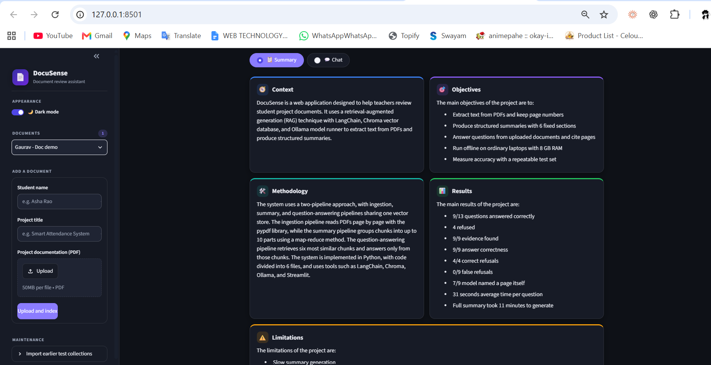
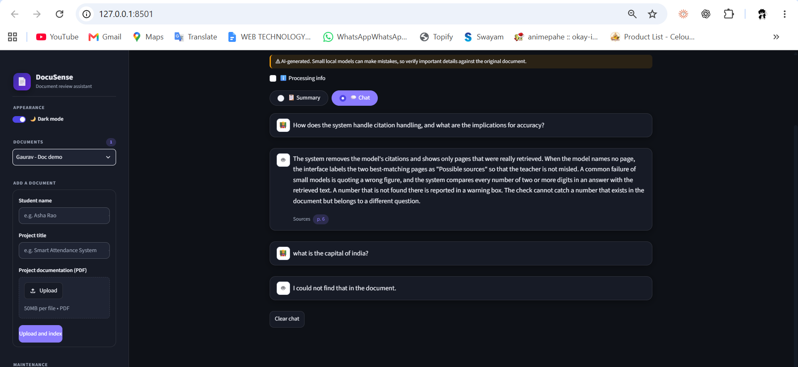
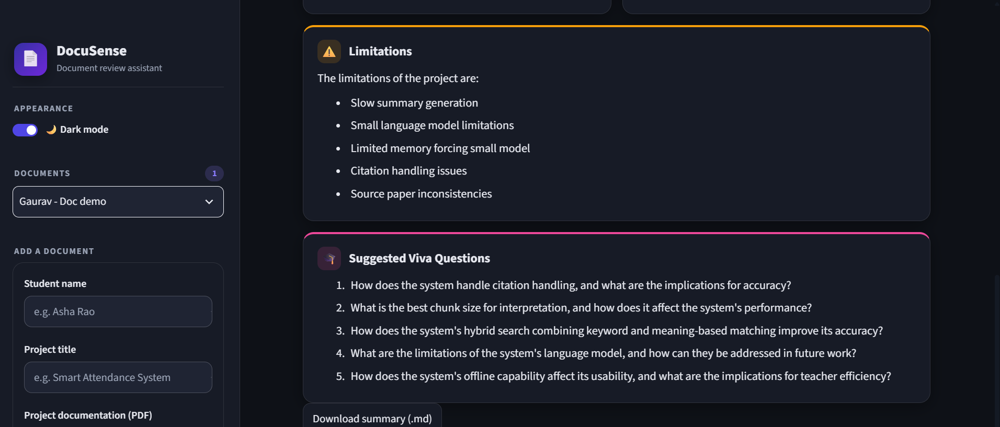
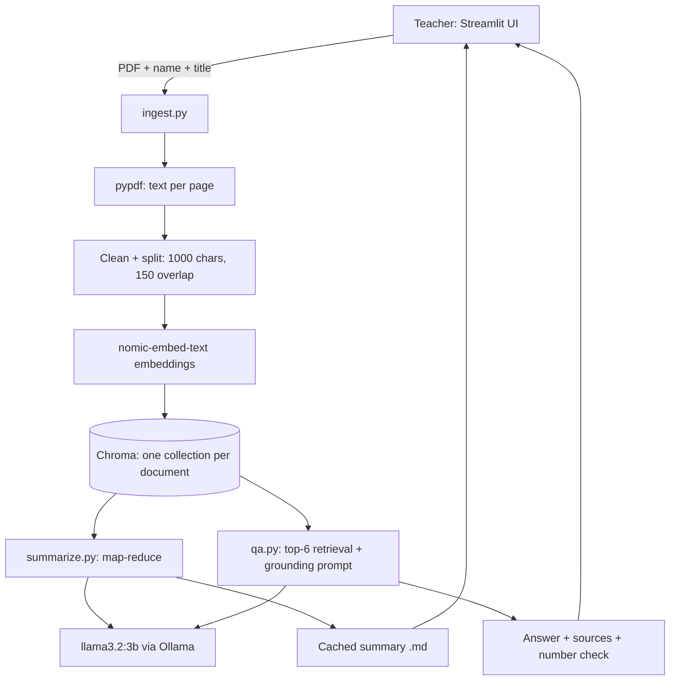

<div align="center">

# 📄 DocuSense

**An AI-powered student documentation summarizer and Q&A assistant**

Upload a project report, get a structured summary, and ask questions that are answered **only from that document**. Runs fully on your own computer with free, open-source tools.


</div>

> **Status:** working prototype, evaluated on one research paper. Read the [Limitations](#limitations) before relying on it.

---

## Screenshots

| Summary view | Chat with sources |
|---|---|
|  |  |



The interface has a **light and a dark theme**, switched from the sidebar.

---

## The problem

Teachers must read long final-semester project reports before a viva. Reading every page is slow, the depth of review varies, and checking one fact means searching by hand. DocuSense gives each report a consistent first-pass review and lets the teacher ask direct questions, with answers tied to page numbers.

It supports the teacher. It does not replace the teacher's judgement, and every screen says so.

## Features

- **Structured summary:** Context, Objectives, Methodology, Results, Limitations and 5 suggested viva questions, shown as colour-coded cards.
- **Grounded Q&A (RAG):** answers come from retrieved passages only. If the document does not support an answer, DocuSense replies exactly: *"I could not find that in the document."*
- **Verification aids:** page sources on answers (labelled "Possible sources" when the model names no page), and a warning when an answer contains a number that is not in the retrieved text.
- **One collection per document:** answers about one student never mix with another.
- **Cached summaries and duplicate detection:** a summary is generated once and saved, and re-uploading the same PDF reuses it.
- **Search animation, light and dark mode, and a built-in processing note.**
- **Privacy by design:** all processing is local. No document text leaves the machine.

## Try it with the demo document

[`docs/DocuSense_Demo_Report.pdf`](docs/DocuSense_Demo_Report.pdf) is a fictional 10-page report written for testing.

1. Start the app (see [Quick start](#quick-start)).
2. In the sidebar, enter a student name and project title, upload the PDF and click **Upload and index**.
3. Click **Generate summary** (about 10 minutes on a CPU).
4. Open **Chat** and try:
   - Answerable: *"Which embedding model does the project use?"*
   - Should be refused: *"What is the capital of France?"* or *"What CGPA did the student get?"*

## Architecture



**Design rules**

- The model never answers from its own knowledge.
- Models and sizes live in one file (`config.py`), so they can be swapped.
- Every failure shows a readable message instead of a crash.
- The app listens only on `127.0.0.1`, and student data folders are excluded from Git.

| File | Job |
|---|---|
| `config.py` | Models, chunk sizes, retrieval and summary settings |
| `ingest.py` | PDF to cleaned chunks to embeddings to Chroma |
| `qa.py` | Retrieval, grounded answer, citation cleanup, number check |
| `summarize.py` | Map-reduce summary with six fixed sections |
| `store.py` | Document registry, summary cache, safe file names |
| `ui.py` | Light/dark styling and display helpers |
| `app.py` | Streamlit interface |
| `evaluate.py` | Retrieval, full Q&A and chunk-size evaluation |
| `test_*.py` | Unit tests that run without Ollama |

## Quick start

Requirements: Python 3.11, [Ollama](https://ollama.com/download), and about 8 GB of RAM (no GPU needed).

```powershell
python -m venv .venv
.\.venv\Scripts\Activate.ps1
pip install -r requirements.txt

ollama pull nomic-embed-text
ollama pull llama3.2:3b
ollama serve                # keep this running in its own terminal

streamlit run app.py        # opens http://127.0.0.1:8501
```

Run the tests (no Ollama needed):

```powershell
python -m unittest discover -p "test_*.py" -v
```

## Performance and processing note

Everything runs on a free local model, so it is slow on an ordinary laptop (about 8 GB RAM, CPU only).

- **Summary:** about 10 minutes. It is saved afterwards, so you only wait once.
- **Chat answer:** about 30 seconds each.
- **Document size:** best for documents of up to about 10 pages. Longer documents are summarised from up to 10 evenly spaced parts, so some pages may be skipped (the summary says so). Chat searches the whole document.

## Evaluation

Measured on one 15-page research paper (49 chunks) with 13 questions: 9 answerable and 4 unanswerable, including two traps that look answerable but are not. The paper is not included in this repository.

| Metric | Result |
|---|---|
| Evidence in top-6 retrieved chunks | 9/9 |
| Answer correct (keyword check) | 9/9 |
| Correct refusals on unanswerable questions | 4/4 |
| False refusals on answerable questions | 0/9 |
| Shown pages contain the evidence | 9/9 |
| Answers with unverified numbers | 0/9 |
| Model named a page itself | 7/9 |
| Average time per question | about 31 s |
| Full summary of the 15-page paper | about 11 min |

**Chunk-size sweep** (evidence found in top-6): 500 characters 8/9, 800 characters 8/9, **1000 characters 9/9**, 1500 characters 8/9. One question is too small a difference to call a real trend, so 1000 is "not worse", not "proven best".

**Honest notes**

- On the English-to-French BLEU question the system answered 41.0. The paper contains both 41.0 and 41.8, so the grader accepts either. DocuSense does not detect conflicting values inside a document.
- The keywords were chosen by the author after reading the paper. Treat these scores as a sanity check, not an accuracy claim.

To re-run: put a PDF in `data/`, ingest it, edit `eval_questions.json` to match it, then run `python evaluate.py <collection_name> --mode full`.

## Limitations

- **Tiny evaluation:** one paper, 13 questions, author-chosen keywords.
- **Small local model:** a 3B model can slip on facts and formatting. Summary errors seen in testing included wrong attributions, a contradictory Objectives section, and a figure that did not match the document ("9/13" for a "9/9" result). Always check the summary against the PDF.
- **Citations are approximate:** sources are pages the model named (if retrieved) or the best-matching retrieved pages, labelled "Possible sources".
- **Number check is narrow:** it catches numbers absent from the retrieved text, not numbers that exist in the document but answer a different question.
- **No protection against prompt injection yet:** text inside an uploaded PDF could try to steer the model.
- **Scanned PDFs are not supported:** no OCR. They are detected and rejected with a clear error. Pages with no text are skipped without a warning.
- **Slow:** see the performance note above.
- **No login and no delete button:** anyone who can open the app sees all documents. Do not expose it on a network.
- **Chunking is per page:** a fact split across a page break is split across chunks.

## Roadmap

- [ ] Prompt-injection tests and hardening
- [ ] Delete-document button and a "pages with no text" warning
- [ ] OCR for scanned PDFs
- [ ] Hybrid keyword + embedding search and re-ranking
- [ ] Optional stronger model (for example a Gemini API key) behind the existing config, with a clear privacy warning
- [ ] Teacher login
- [ ] A larger evaluation set built from real student reports

## Privacy

Uploaded files, indexes and summaries are stored under `data/` and `chroma_db/`, both excluded from Git. Never commit real student work.

## Author

**Gaurav Kumar**
[GitHub](https://github.com/gauravkr2209) · [LinkedIn](https://www.linkedin.com/in/gaurav-kumar-019899383/)


## License

MIT. See [LICENSE](LICENSE).