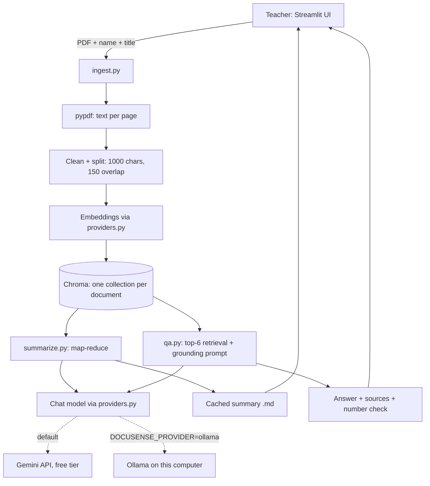

<div align="center">

# 📄 DocuSense

**An AI-powered student documentation summarizer and Q&A assistant**

Upload a project report, get a structured summary, and ask questions that are answered **only from that document**. Runs on Google Gemini (free tier) or fully on your own computer with Ollama.


</div>

> **Status:** working prototype. The local (Ollama) version was evaluated on one research paper. The Gemini version is working but not yet formally evaluated. Read the [Limitations](#limitations) before relying on it.

---

## Screenshots

| Summary view | Chat with sources |
|---|---|
|  |  |


The interface has a **light and a dark theme**, switched from the sidebar.

---

## The problem

Teachers must read long final-semester project reports before a viva. Reading every page is slow, the depth of review varies, and checking one fact means searching by hand. DocuSense gives each report a consistent first-pass review and lets the teacher ask direct questions, with answers tied to page numbers.

It supports the teacher. It does not replace the teacher's judgement, and every screen says so.

## Features

- **Structured summary:** Context, Objectives, Methodology, Results, Limitations and 5 suggested viva questions, shown as colour-coded cards.
- **Grounded Q&A (RAG):** answers come from retrieved passages only. If the document does not support an answer, DocuSense replies exactly: *"I could not find that in the document."*
- **Verification aids:** page sources on answers (labelled "Possible sources" when the model names no page), and a warning when an answer contains a number that is not in the retrieved text.
- **Two model providers:** Google Gemini on the free tier (default), or Ollama running on your own computer. One setting switches between them.
- **One collection per document:** answers about one student never mix with another.
- **Cached summaries and duplicate detection:** a summary is generated once and saved, and re-uploading the same PDF reuses it.
- **Light and dark mode, search animation and a built-in processing note.**

## Try it with the demo document

[`docs/DocuSense_Demo_Report.pdf`](docs/DocuSense_Demo_Report.pdf) is a fictional 10-page report written for testing. It is safe to use with the Gemini free tier.

1. Start the app (see [Quick start](#quick-start)).
2. In the sidebar, enter a student name and project title, upload the PDF and click **Upload and index**.
3. Open **Summary** and click **Generate summary**.
4. Open **Chat** and try:
   - Answerable: *"Which embedding model does the project use?"*
   - Should be refused: *"What is the capital of France?"*

## Architecture



**Design rules**

- The model never answers from its own knowledge.
- Every document records which provider indexed it, because embeddings from different providers cannot be mixed.
- Models and provider choice live in one file (`config.py`). Only `providers.py` talks to the model libraries.
- Every failure shows a readable message instead of a crash.
- The app listens only on `127.0.0.1`, and secrets and student data are excluded from Git.

| File | Job |
|---|---|
| `config.py` | Provider choice, model names, chunk sizes and summary settings |
| `providers.py` | Creates the chat and embedding models for Gemini or Ollama |
| `ingest.py` | PDF to cleaned chunks to embeddings to Chroma |
| `qa.py` | Retrieval, grounded answer, citation cleanup, number check |
| `summarize.py` | Map-reduce summary with six fixed sections |
| `store.py` | Document registry (with provider), summary cache, safe file names |
| `ui.py` | Light/dark styling and display helpers |
| `app.py` | Streamlit interface, including optional demo mode |
| `evaluate.py` | Retrieval, full Q&A and chunk-size evaluation |
| `test_*.py` | Unit tests that run without any model or API key |

## Quick start

Requirements: Python 3.11, and either a free Google Gemini API key or [Ollama](https://ollama.com/download) with about 8 GB of RAM.

```powershell
python -m venv .venv
.\.venv\Scripts\Activate.ps1
pip install -r requirements.txt
```

### Option 1: Gemini (default, free tier)

1. Create an API key in Google AI Studio.
2. Create `.streamlit/secrets.toml` with this one line, using your own key:
```toml
   GOOGLE_API_KEY = "your-key-here"
```
   This file is excluded from Git. Never commit it or paste your key anywhere public.
3. Run the app:
```powershell
   streamlit run app.py
```

Optional: choose a different free chat model with `GEMINI_CHAT_MODEL` (the default is `gemini-3.1-flash-lite`). Check the rate-limit page in AI Studio for the current free limits.

### Option 2: Ollama (fully local)

```powershell
ollama pull nomic-embed-text
ollama pull llama3.2:3b
ollama serve                # keep this running in its own terminal
```

Then, in the same terminal as the app:

```powershell
$env:DOCUSENSE_PROVIDER="ollama"
streamlit run app.py        # opens http://127.0.0.1:8501
```

Documents indexed with one provider cannot be used with the other. The app asks you to index them again.

### Run the tests (no model or API key needed)

```powershell
python -m unittest discover -p "test_*.py" -v
```

## Performance

- **Gemini (free tier):** a summary takes a few minutes. Chat answers take seconds. The free tier has daily and per-minute request limits, and they are shared by everyone using the same key. See the Limitations section.
- **Ollama (local, CPU only):** a summary takes about 10 minutes and a chat answer about 30 seconds. The summary is saved afterwards, so you only wait once.
- **Document size:** best for documents of up to about 10 pages. Longer documents are summarised from up to 10 evenly spaced parts, so some pages may be skipped (the summary says so). Chat searches the whole document.

## Evaluation

The evaluation below was measured on the **local Ollama version** (`llama3.2:3b`, `nomic-embed-text`) on one 15-page research paper (49 chunks) with 13 questions: 9 answerable and 4 unanswerable, including two traps that look answerable but are not. The paper is not included in this repository.

| Metric | Result (Ollama, local) |
|---|---|
| Evidence in top-6 retrieved chunks | 9/9 |
| Answer correct (keyword check) | 9/9 |
| Correct refusals on unanswerable questions | 4/4 |
| False refusals on answerable questions | 0/9 |
| Shown pages contain the evidence | 9/9 |
| Answers with unverified numbers | 0/9 |
| Model named a page itself | 7/9 |
| Average time per question | about 31 s |
| Full summary of the 15-page paper | about 11 min |

**Chunk-size sweep** (evidence found in top-6): 500 characters 8/9, 800 characters 8/9, **1000 characters 9/9**, 1500 characters 8/9. One question is too small a difference to call a real trend, so 1000 is "not worse", not "proven best".

**Gemini:** the same evaluation has not been run on Gemini yet, so no accuracy figures are claimed for it.

**Honest notes**

- On the English-to-French BLEU question the system answered 41.0. The paper contains both 41.0 and 41.8, so the grader accepts either. DocuSense does not detect conflicting values inside a document.
- The keywords were chosen by the author after reading the paper. Treat these scores as a sanity check, not an accuracy claim.

To re-run: put a PDF in `data/`, index it, edit `eval_questions.json` to match it, then run `python evaluate.py <collection_name> --mode full`.

## Limitations

- **Tiny evaluation:** one paper, 13 questions, author-chosen keywords. The Gemini version is not formally evaluated yet.
- **Small local model:** the Ollama version uses a 3B model, which can slip on facts and formatting. Summary errors seen in testing included wrong attributions, a contradictory Objectives section, and a figure that did not match the document. Always check the summary against the PDF.
- **Cloud privacy:** in Gemini mode, document text is sent to Google. Google may use content sent on the free tier to improve its products, and it is subject to Google's terms. Use only non-sensitive documents, such as the demo report, in this mode. For real student work, use Ollama.
- **Free-tier limits:** Gemini free models have daily and per-minute request limits, shared across all users of the same key. When the limit is reached, the app shows a message and works again after the reset.
- **Citations are approximate:** sources are pages the model named (if retrieved) or the best-matching retrieved pages, labelled "Possible sources".
- **Number check is narrow:** it catches numbers absent from the retrieved text, not numbers that exist in the document but answer a different question.
- **No protection against prompt injection yet:** text inside an uploaded PDF could try to steer the model.
- **Scanned PDFs are not supported:** no OCR. They are detected and rejected with a clear error. Pages with no text are skipped without a warning.
- **No login and no delete button:** anyone who can open the app sees all documents. Do not expose it on a network.
- **Chunking is per page:** a fact split across a page break is split across chunks.

## Roadmap

- [ ] Formal evaluation of the Gemini version, and a comparison with the local model
- [ ] Prompt-injection tests and hardening
- [ ] Delete-document button and a "pages with no text" warning
- [ ] OCR for scanned PDFs
- [ ] Hybrid keyword + embedding search and re-ranking
- [ ] Public demo with uploads disabled
- [ ] Teacher login
- [ ] A larger evaluation set built from real student reports

## Privacy

- **Local mode (Ollama):** nothing leaves your computer.
- **Gemini mode:** document text and questions are sent to Google's API. Do not use real student work with the free tier.
- Uploaded files, indexes and summaries are stored under `data/` and `chroma_db/`, and API keys in `.streamlit/secrets.toml`. All three are excluded from Git.

**[Live demo](https://docsenseprojecta.streamlit.app/)** (Gemini free tier, demo document only)

## Author

**Gaurav Kumar**
[GitHub](https://github.com/gauravkr2209) · [LinkedIn](https://www.linkedin.com/in/gaurav-kumar-019899383/)

## License

MIT. See [LICENSE](LICENSE).